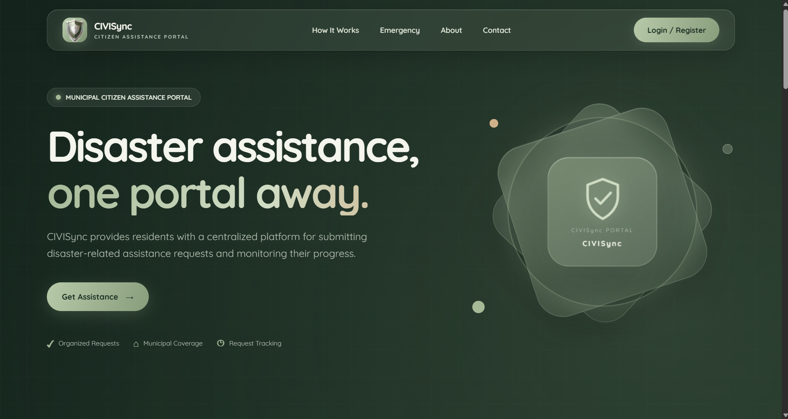
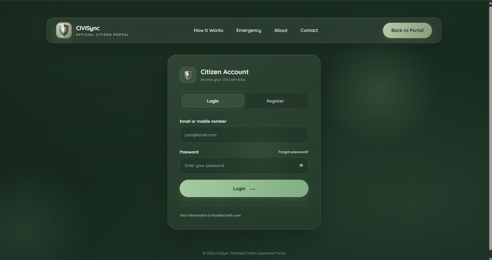
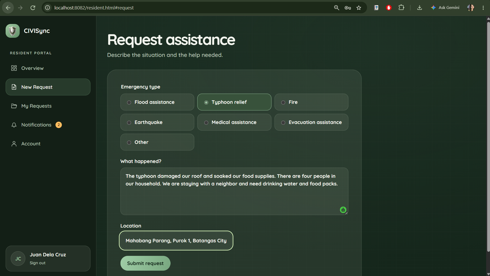
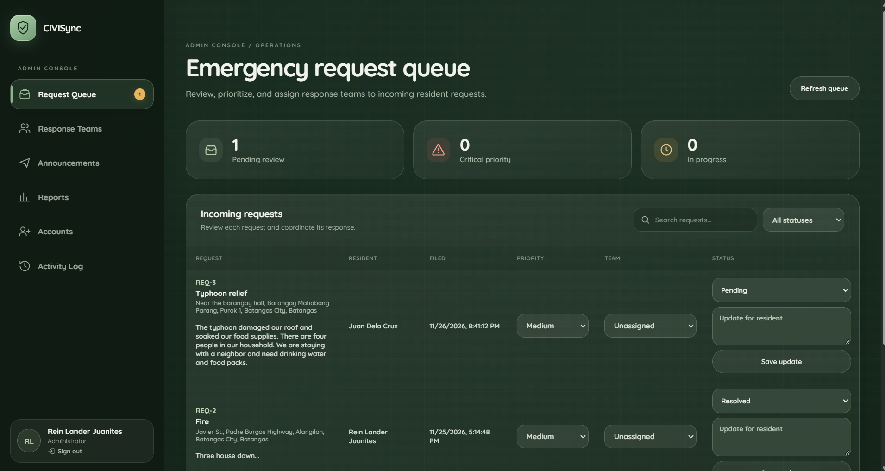
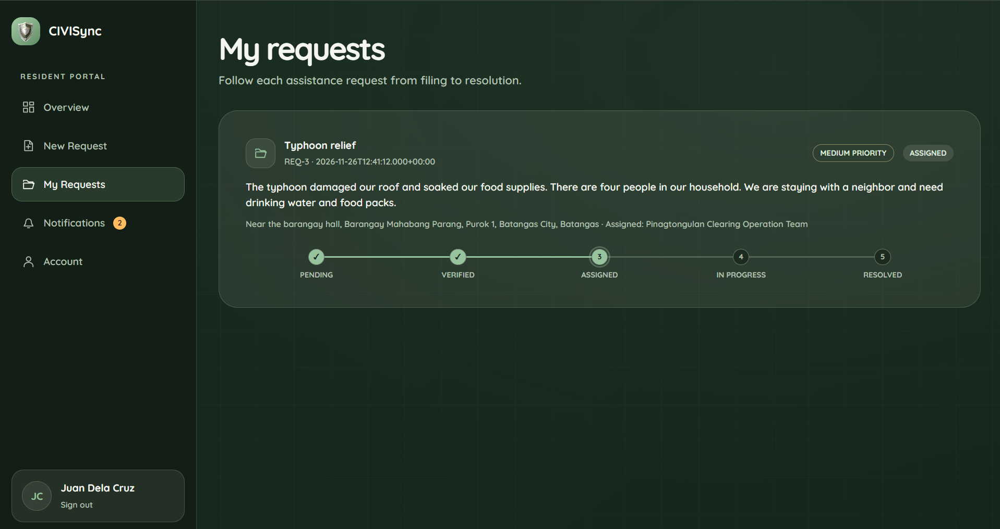

<h1 align="center"><b>CIVISync</b></h1>

<h3 align="center">
  Java-Based LGU Citizen Assistance and Disaster Response Queue System
</h3>

<p align="center">
  <strong>OOP 101 · Object-Oriented Programming</strong><br>
  CS 2105
</p>

<p align="center">
  Juanites, Rein Lander B. <br>
  Robledo, Shaira P.<br>
  Perez, Samantha Isabel 
</p>

<p align="center">
  <strong>College of Informatics and Computing Sciences</strong><br>
  Batangas State University · Alangilan Campus
</p>

---

## 📖 Overview

CIVISync is a Java web application that helps residents request disaster-related assistance and helps local government unit (LGU) staff coordinate a response. A resident can describe what happened, provide a location, and check the progress of the request. Staff use a shared queue to review requests, assess priority, assign response teams, and send updates.

The project addresses two questions that arise after a request is filed: **Who is handling it?** and **How can the resident find out what has happened?** CIVISync connects both portals to the same request record. When a staff member saves a status or note, the resident can open that request and see the update.

## 🎯 Project Objectives

- Give residents one place to submit and track assistance requests.
- Help LGU staff review incoming requests, assess urgency, and coordinate response teams.
- Keep a record of request details, assignments, and staff updates.
- Give residents access to public advisories and municipal contact information.

## 👥 Target Users and Features

| User | What they can do |
| --- | --- |
| **Public visitor** | View disaster advisories, evacuation information, and municipal contact details. |
| **Resident** | Register, sign in, file an assistance request, and check its status and staff updates. |
| **LGU staff** | Review the request queue, set priorities, assign response teams, save status updates, and publish announcements. |

### How a request moves through CIVISync

1. A resident signs in and submits the category, location, and details of an assistance request.
2. The request appears in the staff **Request Queue** with an initial status of **Pending**.
3. A staff member reviews the details, selects a priority, assigns a team when appropriate, and saves an update.
4. The resident opens **My Requests** to read the latest status and note.

## 🗃️ Data Handling

| MariaDB table | What it stores |
| --- | --- |
| `accounts` | Resident and staff profiles, roles, and password hashes |
| `requests` | Request details, resident ID, priority, assigned team, status, and latest note |
| `teams` | Response team names, categories, leaders, and member counts |
| `notices` | Published advisories, their authors, and publication dates |
| `activity` | Recorded actions, the accounts that performed them, and timestamps |

## ☕ Java and OOP Implementation

The shared login provides an example of the four OOP principles working together. Residents and staff sign in through the same form, but each account type determines its own landing page.

| OOP principle | Application in CIVISync |
| --- | --- |
| **Abstraction** | The login handler works with the common `PortalAccount` type. It asks the account for a landing page without needing the details of each portal. |
| **Encapsulation** | Each account type keeps its landing-page decision inside `landingPage()`. The login handler retrieves the result through that method. |
| **Inheritance** | `ResidentAccount` and `StaffAccount` specialize `PortalAccount`, allowing both roles to share common account behavior. |
| **Polymorphism** | The same `account.landingPage()` call runs the implementation for the signed-in account. A resident reaches the resident portal, while a staff member reaches the staff portal. |

The login success handler in `SecurityConfig.java` shows the method call:

```java
var account = (PortalAccount) auth.getPrincipal();
res.setContentType("text/plain");
res.getWriter().print(account.landingPage());
```

The security configuration also checks the user’s role when a protected page or API is requested.

## 🛠️ Technologies Used

| Part of the project | Technologies |
| --- | --- |
| Frontend | HTML, CSS, JavaScript |
| Backend | Java 17, Spring Boot, Spring Security |
| Database | MariaDB |
| Local database tools | XAMPP, phpMyAdmin |
| Build and version control | Maven Wrapper, Git, GitHub |

## ▶️ How to Run the Program

### 1. Download the project

Install **JDK 17**, **Git**, and **XAMPP**. Open PowerShell and run:

```powershell
git clone https://github.com/shai-y/CIVISync.git
cd CIVISync
java -version
```

The project folder should contain `pom.xml` and `mvnw.cmd`.

### 2. Set up the database

1. Open the **XAMPP Control Panel** and start **MySQL** and **Apache**.
2. Click **Admin** beside MySQL to open phpMyAdmin.
3. For a fresh installation, create an empty database named `lgu_assist_oop`.
4. Select that database, open **Import**, and choose `database/create.sql` from the project.
5. Run the import. Confirm that `accounts`, `activity`, `notices`, `requests`, and `teams` appear.

If your existing CIVISync database already contains these tables and your project records, skip the import.

### 3. Connect Spring Boot to MariaDB

Open `src/main/resources/application.properties`. Check the database name and port in `spring.datasource.url` and the account in `spring.datasource.username`.

For the team's local setup, the application account is `lgu_app`. On a fresh installation, create that local MariaDB user and grant it `SELECT`, `INSERT`, and `UPDATE` on `lgu_assist_oop.*`. Supply its password using the local configuration referenced by `spring.datasource.password`. Keep the actual password out of the repository.

### 4. Start CIVISync

From the project folder, run:

```powershell
.\mvnw.cmd spring-boot:run
```

Open the localhost address using the port shown in the Spring Boot startup log. For example, if the application starts on port `8082`, open `http://localhost:8082/`.

### 5. Try the resident and staff workflow

1. Open **Login / Register**, create a test resident account, and file a sample request.
2. For a fresh classroom setup, register a second test account. In the local database, edit that second account’s `role` in `accounts` to `STAFF`.
3. Sign in to the staff account in a separate browser or private window.
4. In the staff portal, open **Response Teams** and add one test team. On a fresh database, this gives you a team to select in the request queue.
5. Open **Request Queue** and find the request filed in step 1. Select the test team, set the status to **Assigned**, enter a note under **Update for resident**, and click **Save update**.
6. Return to the resident’s browser window and refresh **My Requests**. Open the same request number and confirm that the status is **Assigned** and the note matches what staff entered.

## 📂 Project Structure

| Location | Purpose |
| --- | --- |
| `src/main/java/` | Java application entry point, configuration, controllers, models, and services |
| `src/main/resources/static/` | Public, login, resident, and staff pages with their CSS, JavaScript, and images |
| `src/main/resources/application.properties` | Database connection and application settings |
| `database/create.sql` | Database tables, indexes, and relationships |
| `docs/` | Project documentation |
| `screenshots/` | Application images used in Example Output |
| `pom.xml` | Maven dependencies and build configuration |
| `mvnw` and `mvnw.cmd` | Maven Wrapper launchers |

## 🖼️ Example Output

### 1. Resident/Staff opens the homepage

The home page shows directory to logging in / signing up.



### 2. Login / Sign Up page

The page verifies users' identity to access a private account, restricted features, or authenticated areas of the system.



### 3. Resident submits an assistance request

The resident’s **My Requests** page shows the newly filed request and its initial status.



### 4. LGU staff review and update the request

The staff **Request Queue** shows the same request with its priority, assigned team, status, and update for the resident.



### 5. Resident views the saved update

The resident opens the request again to see the status and note saved by staff.



## 📌 Known Limitations

- Staff assess urgency and assign teams manually.
- Residents see the latest information staff have saved. A change in field conditions requires a staff update before it appears in the portal.
- The classroom setup requires a running Spring Boot application and MariaDB database.

## 🔭 Future Improvements

- Add opt-in notifications when a request changes status.
- Show a timeline of status changes so residents can follow a request from submission to resolution.
- Let staff filter past requests by barangay and date to review patterns in assistance needs.

## 🤝 Contributors

| Team member | Primary role |
| --- | --- | 
| Rein Lander B. Juanites | System Architect | 
| Shaira Robledo | Main Programmer |
| Samantha Isabel Perez | Documenter |

## 🎓 Acknowledgements

CIVISync was developed for OOP 101 at Batangas State University, Alangilan Campus. The team thanks its instructor and classmates for their feedback throughout the project.

<p>Early Java prototype contributed by ReinLander: <b> [https://github.com/shai-y/CIVISync/commit/e802ba3aa5a619d47a6c409216a079531611894a]</b></p> </p>
